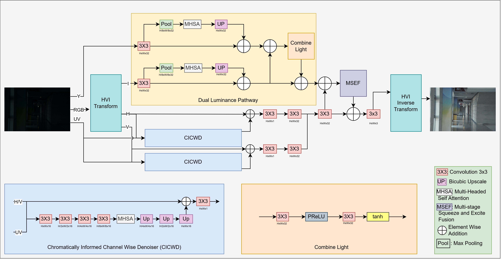

# DuLL-Net

> **Efficient Low Light Image Enhancement with Dual Luminance and Colour Space**  
> **Bill Rayner, [Saeed Anwar](https://scholar.google.com/citations?user=vPJIHywAAAAJ&hl=en)**

[](https://pytorch.org/)
[](LICENSE)

---
## 📌 Overview

* **DuLL-Net** is a lightweight low-light image enhancement model that leverages both HVI and YUV colourspaces for a stable and effective illumination estimation.
* It introduces a **Chromatically Informed Channel-wise Denoiser** for richer noise suppression alongside a **Dual Luminance Pathway** to process illumination across separated channels efficiently.
* As the first HVI-based lightweight architecture, DuLL-Net achieves state-of-the-art performance on diverse paired and unpaired benchmarks while offering key insights into colour-space selection for low-light tasks.
* The PyTorch implementation was developed based on the PyTorch implementation of the [LYT-Net](https://github.com/albrateanu/LYT-Net) model.

### Key Features
- **Dual-Colour Space Illumination Decoupling:** Exploits complementary HVI and YUV colour spaces to separate illumination processing from denoising, maximizing parameter efficiency for structural detail and colour fidelity.
- **Novel Modules:** Incorporates a *Chromatically Informed Channel-wise Denoiser* for rich colour-aware noise reduction and a *Dual Luminance Pathway* for multi-space illumination handling.
- **SOTA Performance & Pioneering Analysis:** Outperforms existing lightweight models on both paired and unpaired benchmarks, featuring the first in-depth analysis of the HVI colour space for low-light enhancement.

## 🏗️ Architecture



## 🛠️ Installation

### Prerequisites
- Linux / macOS / Windows
- Python ≥ 3.8
- CUDA ≥ 11.7 (Optional, but recommended for GPU acceleration)

### 📊 Benchmark Results
#### Model Size
| Parmas(M) | FLOPs(G) |
| -------- | -------- |
|0.069 | 6.40 |

#### Without GT Mean Correction
| Dataset | PSNR | SSIM |
| ------- | -------- | -------- |
| LOLv1   | 23.00    |  0.837   |
| LOLv2-Real  | 22.71 |  0.861  |
| LOLv2-Syn  |  24.43   | 0.921  |

#### With GT Mean Correction
| Dataset | PSNR | SSIM |
| ------- | -------- | -------- |
| LOLv1   |  26.36   | 0.852 |
| LOLv2-Real  | 29.19  |  0.887   |
| LOLv2-Syn  | 28.58   | 0.935  |


#### Pretrained Weights 
The weights for the above results are available in this [Google Drive](https://drive.google.com/drive/folders/1ZckMn_AeVZ0UWu1b6ZDYhwS_xXumOY0y?usp=sharing).

### 🚀 Quick Start
#### 1. Data Setup
```
dataset/
├── train/
│   ├── inputs/
│   └── targets/
└── test/
    ├── inputs/
    └── targets/
```
#### 2. Training
`python PyTorch/train.py`

#### 3. Testing
`python PyTorch/test.py`

### 📜 License
This project is released under the MIT License.
